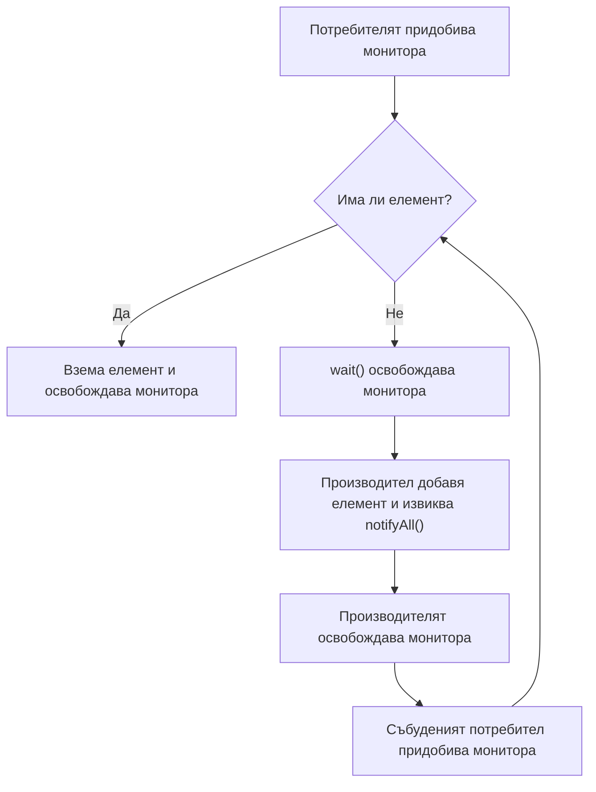
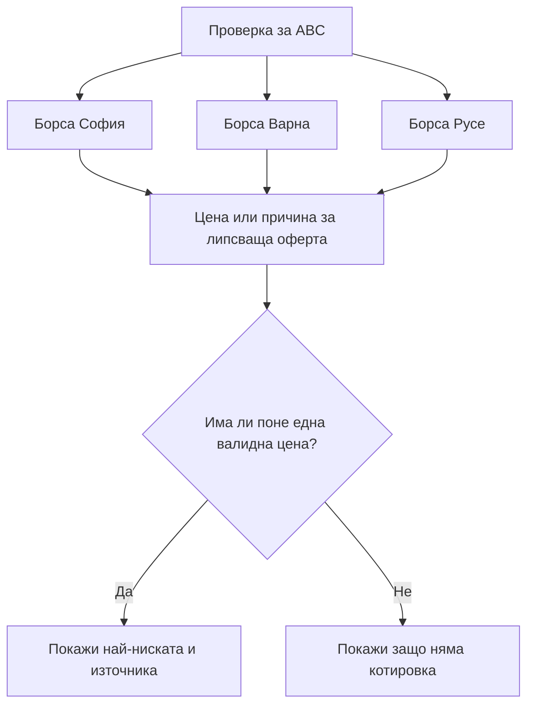

# Фаза 1 — Java Concurrency и Networking

## Кой изпълнява кода?

Представи си програма, която чете котировки от две борси. Тя изпраща заявка до първата и чака 300 милисекунди за отговор. През това време би могла да попита и втората. Двете заявки могат да са в ход едновременно дори на компютър с едно процесорно ядро. Това е **конкурентност** (*concurrency*) — периодите на изпълнение на задачите се припокриват. **Паралелизъм** има, когато две изчисления действително се изпълняват в един и същ момент.

Когато стартираш Java приложение, операционната система създава **процес** със собствено адресно пространство. В него работи виртуалната машина на Java (JVM). Един процес може да има много **нишки**. Всяка има собствен стек с извикванията на методи и локалните им променливи. Две локални променливи в различни нишки обаче могат да сочат към един и същ обект. Точно така няколко нишки получават достъп до една и съща опашка.

В Java `Runnable` описва действие чрез метод `run()`, който не връща стойност. `Thread` представлява нишката, която може да го изпълни. В примера `() -> ...` е кратък запис за действието.

```java
Runnable report = () -> System.out.println(Thread.currentThread().getName());
Thread worker = new Thread(report, "quotes");

worker.start();
worker.join();
```

`start()` прави новата нишка готова за изпълнение. Ако извикаш директно `worker.run()`, кодът ще се изпълни в извикващата нишка. `join()` изчаква края на `worker`. Докато чака, извикващата нишка може да получи сигнал за прекъсване. Сигналът се изпраща с `interrupt()`. Тогава `join()` хвърля `InterruptedException`, който обграждащият метод може да предаде нагоре с `throws`. Прекъсването е начин да поискаш прекратяване на работа. Нишката трябва да реагира на сигнала.

## Как две увеличения дават единица

Нека две нишки приключат по една заявка и всяка изпълни `completed++` върху общо поле. Изразът включва прочитане на старата стойност, добавяне на единица и запис. При начална стойност нула е възможен следният ред.

| Стъпка | Нишка А | Нишка Б | Поле `completed` |
|---|---|---|---|
| 1 | Прочита 0 | | 0 |
| 2 | | Прочита 0 | 0 |
| 3 | Записва 0 + 1 | | 1 |
| 4 | | Записва 0 + 1 | 1 |

Това е **race condition** — коректността на резултата зависи от реда, в който нишките извършват отделните стъпки. Същият проблем се вижда в твоята `MutexQueue`. Дори `isEmpty()` и `pop()` поотделно да са безопасни за едновременно извикване, друга нишка може да вземе последния елемент между двете извиквания. Ако `pop()` връща `null` при празна опашка, едно извикване и проверка на резултата решават този конкретен проблем.

Една операция е **атомарна**, когато останалите нишки могат да я наблюдават като една неделима стъпка. Един клас е **thread-safe**, когато при позволените от договора му едновременни извиквания запазва обещаното поведение. За опашката това включва например един добавен елемент да може да бъде взет само веднъж.

## Какво гарантира синхронизацията

В Java всеки обект има **монитор** с ключалка, която в даден момент може да се държи само от една нишка. С `synchronized (mutex)` нишката придобива ключалката на обекта `mutex` и я освобождава при излизане от блока, включително при изключение. Кодът вътре е **критична секция**. Ако всички увеличения на брояча използват един и същ монитор, втората нишка ще може да прочете стойността едва след като първата я е обновила.

Има и втора гаранция — **видимост**. Да кажем, че А записва котировка и излиза от синхронизиран блок. Когато Б впоследствие влезе в блок със същия монитор, записът на А вече е видим за Б. Java описва това чрез отношението **happens-before**. То свързва действия, за които езикът гарантира ред и видимост. Самото наблюдение, че А обикновено приключва няколко милисекунди по-рано, не създава такава гаранция.

`volatile` също дава гаранция за видимост. Например една нишка подготвя резултат и после записва `true` в поле `volatile boolean ready`. Ако втора нишка прочете тази стойност, предшестващият запис на резултата също е видим за нея. Този прост пример предполага еднократно публикуване. При брояча от таблицата `volatile int completed` пак допуска и двете нишки да прочетат нула преди първия запис.

| Средство | Какво позволява | Пример |
|---|---|---|
| `synchronized` | Само една нишка в защитената секция за даден монитор. Освобождава автоматично ключалката. | Добавяне на стойност и преместване на индекса в масив. |
| `Lock` | Явно придобиване и освобождаване на ключалка. `ReentrantLock` е реализация с `tryLock()` за опит без чакане. | Ако ключалката е заета, отлагаш незадължителна операция. След успешно придобиване освобождаваш в `finally`. |
| `volatile` | Публикуване на стойност между нишки, без взаимно изключване. | Флаг за спиране, който работещата нишка проверява периодично. |
| `Semaphore` | Брояч на разрешения. `acquire()` взема разрешение или чака, а `release()` връща едно. | Най-много три едновременни заявки към една борса. |

## Кога чакането има край

В твоята блокираща опашка има особен момент. Потребителят проверява дали има елемент, докато държи монитора. Ако задържи ключалката, докато чака, производителят няма как да добави нищо. Затова `wait()` освобождава точно монитора, върху който е извикан, и приспива нишката. Преди да се върне от `wait()`, тя отново трябва да придобие същия монитор.



`notify()` събужда една чакаща нишка по избор на JVM. `notifyAll()` събужда всички чакащи на този монитор. Ако има един елемент и двама събудени потребители, първият може да го вземе, преди вторият да си върне ключалката. Затова условието се проверява в `while`. Цикълът покрива и позволеното от Java събуждане без известие. И чакането, и известяването се правят, докато нишката държи съответния монитор.

Твоята `Pipe` решава същия проблем с друга информация. Разрешение от `empty` означава, че производител може да заеме свободна клетка. Разрешение от `full` означава, че потребител може да вземе публикуван елемент. Ако производител вече е взел разрешение от `empty`, но бъде прекъснат, докато чака ключалката за запис, той трябва да върне разрешението. Иначе опашката постепенно губи използваем капацитет. В стандартната библиотека `BlockingQueue<T>` предлага този договор чрез `put()` и `take()`. `ArrayBlockingQueue<T>` е реализация с фиксиран капацитет.

Особен случай на безкрайно чакане е **deadlock**. Например А държи ключалката на първата опашка и чака втората, а Б държи втората и чака първата. Всяка чака действие, което само другата може да извърши. Ако всяко прехвърляне придобива двете ключалки в един и същ предварително определен ред, този цикъл става невъзможен.

## Задачи, изпълнители и резултати

Ако трябва да обработиш сто задачи, рядко ти е нужно да управляваш лично сто обекта `Thread`. `ExecutorService` приема задачи, организира изпълнението им и позволява да спреш приемането на нови. Един вариант е **пул** — група нишки, всяка от които след приключване на задача взема следващата.

`Callable<T>` описва задача, която връща резултат от тип `T` и може да хвърли изключение. Когато я подадеш чрез `submit()`, получаваш `Future<T>` — обект, чрез който по-късно можеш да поискаш резултата. В този откъс двата метода пресмятат стойности от тип `double` за две независими стратегии.

```java
try (ExecutorService pool = Executors.newFixedThreadPool(2)) {
    Callable<Double> first = () -> evaluateTrend();
    Callable<Double> second = () -> evaluateMomentum();

    Future<Double> trend = pool.submit(first);
    Future<Double> momentum = pool.submit(second);

    System.out.println(trend.get() - momentum.get());
}
```

И двете задачи са подадени преди първото `get()`, затова могат да се изпълняват паралелно. `get()` блокира извикващата нишка до получаване на резултата. Ако задачата хвърли изключение, `get()` го предава обвито в `ExecutionException`. Вариантът `get(1, TimeUnit.SECONDS)` ограничава чакането до секунда. Задачата може да продължи и след изтичането ѝ. `cancel(true)` прави опит да я прекъсне. В Java 21 използваният тук блок `try (...)` автоматично затваря изпълнителя при излизане и при нормално приключване изчаква подадените задачи.

За избор на изпълнител има значение **къде отива времето**. Пресмятането на стратегия върху милион цени е предимно *CPU-bound* — скоростта му зависи от процесора. За независими такива изчисления разумна начална големина на пула е около броя на достъпните процесорни ядра. Четенето на котировка през мрежата често е *I/O-bound* — голяма част от времето минава в чакане на данни. Докато една заявка чака, друга може да напредне. За да видим какво точно чака нишката, трябва да погледнем другия процес.

## Какво преминава между два процеса

Ако две нишки получат един и същ обект `mutex`, могат да координират достъпа си чрез неговия монитор. Ако стартираш програмата два пъти, всяка JVM създава собствени обекти. Дори полето да е `static` и в двата процеса да се казва `mutex`, всеки заключва своя обект. За да поискат нещо един от друг, процесите могат да обменят съобщения.

**TCP** позволява на два процеса да установят връзка и да обменят подреден поток от байтове. Програмата работи с край на тази връзка, наречен **сокет**. Сървърът слуша на адрес и **порт** — номер, по който операционната система насочва връзката към него. TCP запазва реда на байтовете, но едно записване при изпращача може да бъде прочетено на няколко части при получателя. Затова приложенията се договарят къде свършва едно съобщение.

**HTTP** задава такъв договор за заявки и отговори. Например при HTTP/1.1 клиентът може да изпрати по TCP заявка с метод `GET` и път `/quotes/ABC`. Сървърът връща код за резултата, заглавни полета с допълнителна информация и евентуално тяло с данни. Код `200` означава успех, а `503` означава, че услугата временно не може да обслужи заявката.

В Java `HttpClient` изпраща заявките, а `HttpRequest` описва една заявка. Следният откъс чете от локален сървър. `BodyHandlers.ofString()` указва тялото на отговора да се прочете като текст.

```java
var client = HttpClient.newBuilder()
        .connectTimeout(Duration.ofMillis(300))
        .build();
var request = HttpRequest.newBuilder(URI.create("http://localhost:8081/quotes/ABC"))
        .timeout(Duration.ofSeconds(1))
        .GET()
        .build();

var response = client.send(request, HttpResponse.BodyHandlers.ofString());
System.out.println(response.statusCode());
```

Клиентът може да се използва за много заявки и да преизползва вече установени връзки. `connectTimeout` ограничава чакането за установяване на **нова връзка**. Срокът върху `request` ограничава чакането за HTTP отговор. И двата срока се различават от този на `Future.get(...)`, който определя колко дълго извикващата нишка ще чака дадена задача.

| Какво наблюдава клиентът | Какво може да заключи |
|---|---|
| Връзката е отказана | Не е установена връзка. При локален тест обичайната причина е, че никой не слуша на този порт. |
| Получен е HTTP `503` | Има валиден HTTP отговор с код за грешка. В Java `send()` връща отговора и приложението проверява кода. |
| Заявката е изпратена, но срокът изтича | Отговорът не е получен навреме. Сървърът може вече да е извършил действието. |

Последният случай има значение за Orqbit. Представи си, че сървърът записва нова задача, но връзката прекъсва, преди клиентът да получи нейния номер. Ако клиентът повтори заявката за създаване, може да се появи втора задача. Общ идентификатор за двата опита позволява на сървъра да разпознае повторението, ако пази идентификатора заедно със създадената задача и гарантира уникалността му. При заявка за прочит на котировка повторението е по-просто, макар че цената междувременно може да се е променила.

## Два начина да изчакаш котировките

При `client.send(...)` нишката чака отговора на мястото на извикването. **Платформената нишка** е свързана с нишка на операционната система за целия си живот. **Виртуалната нишка**, налична като стандартна възможност от Java 21, се планира от JVM върху платформени нишки. Когато виртуална нишка чака при поддържана мрежова операция, JVM обикновено може да използва платформената нишка за друга работа. Така кодът за една заявка остава последователен, докато много заявки чакат едновременно.

`Executors.newVirtualThreadPerTaskExecutor()` създава отделна виртуална нишка за всяка подадена задача. Ако борсата може да обслужва до три едновременни заявки от клиента, това все още е реално ограничение. Един споделен `Semaphore(3)` около изпращането изразява точно него. Разрешението се връща в `finally` след успешно придобиване, включително при мрежова грешка.

Друг подход е `client.sendAsync(...)`. Методът веднага връща `CompletableFuture`. Подобно на `Future`, този обект представлява бъдещ резултат, но позволява и да опишеш какво да се случи, когато резултатът стане наличен. С `thenApply` преобразуваш успешния резултат. С `thenCombine` събираш два успешни резултата, които може да пристигнат в произволен ред. Следният откъс предполага две вече създадени заявки.

```java
var body = HttpResponse.BodyHandlers.ofString();
var first = client.sendAsync(firstRequest, body);
var second = client.sendAsync(secondRequest, body);

var summary = first.thenCombine(second,
        (a, b) -> a.statusCode() + " / " + b.statusCode());
System.out.println(summary.join());
```

Тук `join()` е метод на `CompletableFuture` и чака крайния резултат. Ако едната заявка приключи с мрежово изключение, комбинирането също завършва с грешка. Ако искаш да запазиш отговора от работещата борса, можеш да използваш `handle` върху **всяка** заявка преди комбинирането. Той получава резултата или изключението и позволява да представиш и двата изхода като данни. При варианта с виртуални нишки същата логика се изразява с обикновен `try/catch` вътре в задачата.

### Официални справки

[Модел на паметта и монитори](https://docs.oracle.com/javase/specs/jls/se21/html/jls-17.html) · [Конкурентност в Java 21](https://docs.oracle.com/en/java/javase/21/docs/api/java.base/java/util/concurrent/package-summary.html) · [Виртуални нишки](https://docs.oracle.com/en/java/javase/21/core/virtual-threads.html) · [HttpClient](https://docs.oracle.com/en/java/javase/21/docs/api/java.net.http/java/net/http/HttpClient.html) · [TCP](https://www.rfc-editor.org/rfc/rfc9293.html) · [HTTP](https://www.rfc-editor.org/rfc/rfc9110.html)

## Мини проект — коя борса предлага най-добра цена?

Имаш три източника на котировки за една и съща акция. Единият обичайно е бърз, вторият понякога предлага по-добра цена, а третият от време на време спира да отговаря. Напиши конзолна програма, която за всяка проверка пита и трите и извежда най-ниската получена цена за покупка. До нея показва колко източника са отговорили навреме. Така читателят може да различи „най-добра от три оферти“ от „единствена налична оферта“.

Самите борси могат да бъдат **една малка Java програма**, стартирана три пъти с различни портове. За локалния HTTP сървър е достатъчен класът `HttpServer` от пакета `com.sun.net.httpserver`. Всеки екземпляр обслужва `GET /quotes/ABC` и връща цена в цели стотинки. При стартиране задаваш порт, цена, забавяне и HTTP код. Така можеш да възпроизведеш едно и също пазарно състояние при всяко пускане.



Клиентът започва трите заявки, преди да изчака първия резултат. Дава на всяка заявка срок от една секунда. За валидна оферта приема HTTP `200` и положителна цена в стотинки. Всяка задача връща собствен резултат с името на борсата и цена или причина за неуспех. Така сравнението на цените може да се направи на едно място, след като изходът от трите заявки е известен. За реализацията избери единия от двата модела от предния раздел.

Например София предлага цена `10120` след 80 ms, Варна предлага `10090` след 250 ms, а Русе предлага `9990` след 2000 ms. При срок от една секунда клиентът извежда следния резултат.

```text
ABC   100.90 лв.   Варна   2/3 валидни оферти
София   101.20 лв.
Варна   100.90 лв.
Русе    изтекъл срок
```

Поведението на клиента се вижда най-добре при три промени в този пример.

- Нека и трите борси отговарят след 400 ms. Една проверка трябва да трае приблизително колкото най-бавния отговор плюс местните разходи. Време около 1200 ms подсказва последователно изчакване.
- Върни `503` от едната борса и спри процеса на друга. Клиентът трябва да покаже цената от третата и две различни причини за липсващите оферти. Ако спреш и третата, резултатът е „няма котировка“.
- Разшири пътя до `/quotes/{symbol}`, така че сървърът да приема произволен символ. Подай десет символа наведнъж. За да може локалният сървър да обработва застъпващи се заявки, дай му изпълнител чрез `HttpServer.setExecutor(...)` преди стартиране. Ограничи клиента до три активни заявки **на борса**, със споделен семафор за всеки източник. На сървъра отчитай под една ключалка колко заявки се обработват в момента и най-голямата наблюдавана стойност. При серия от бавни отговори под едносекундния срок трябва да видиш припокриване на заявки и максимум до три за всяка борса.
